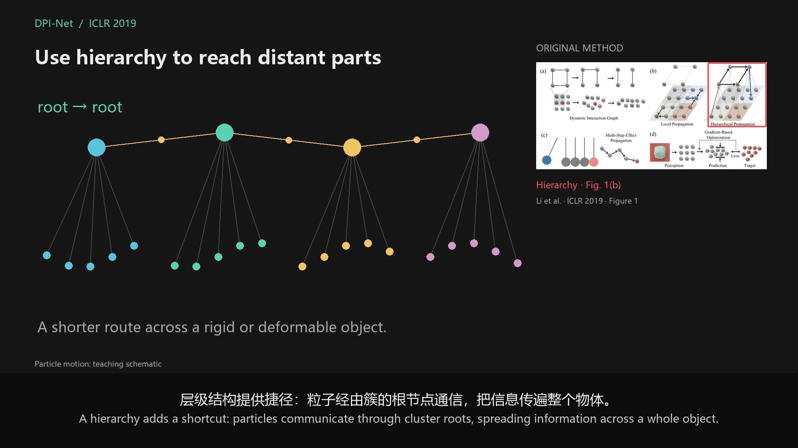
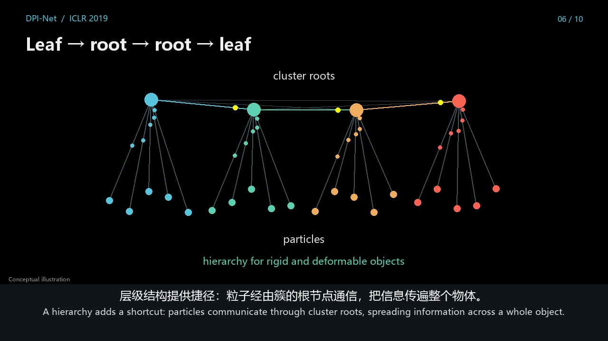
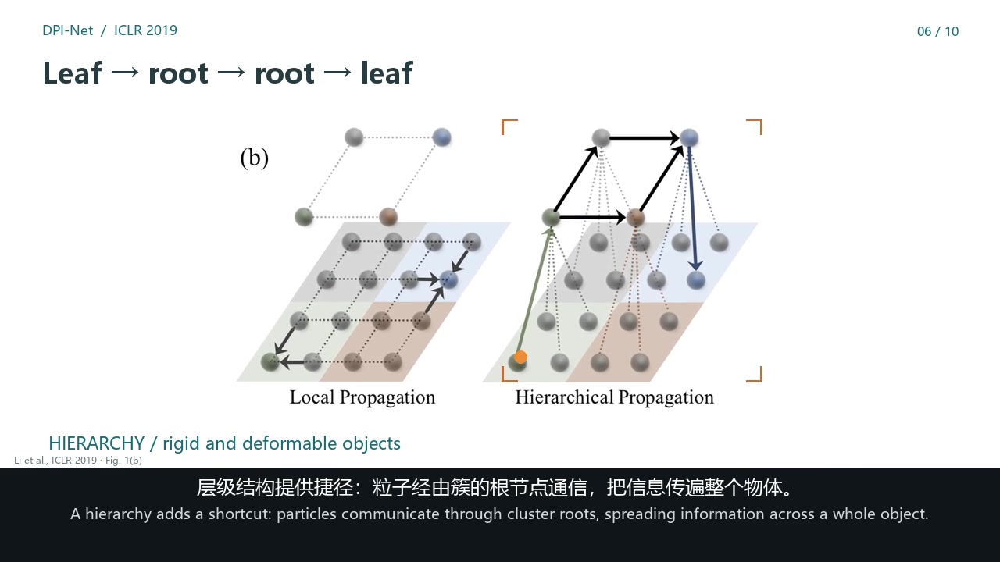
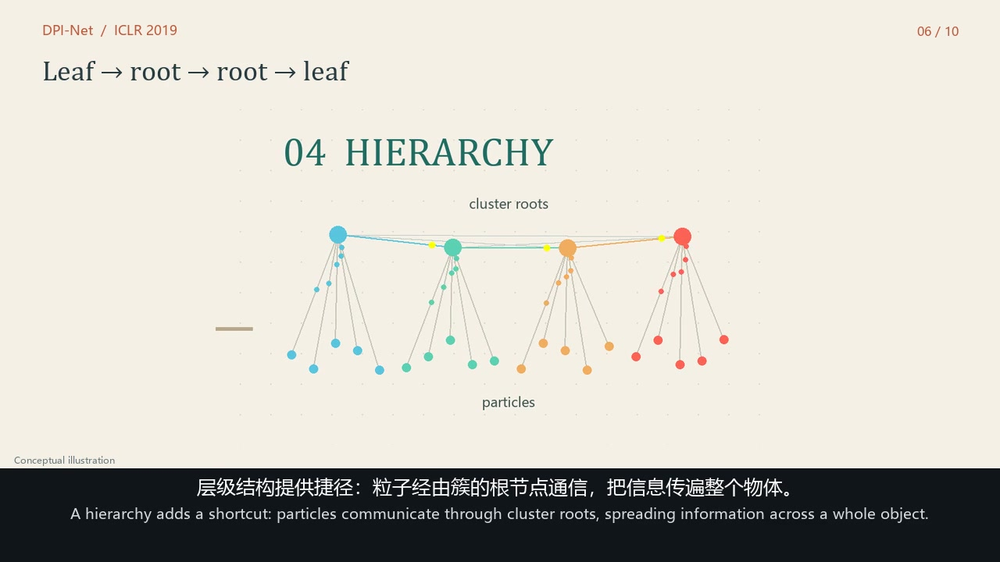
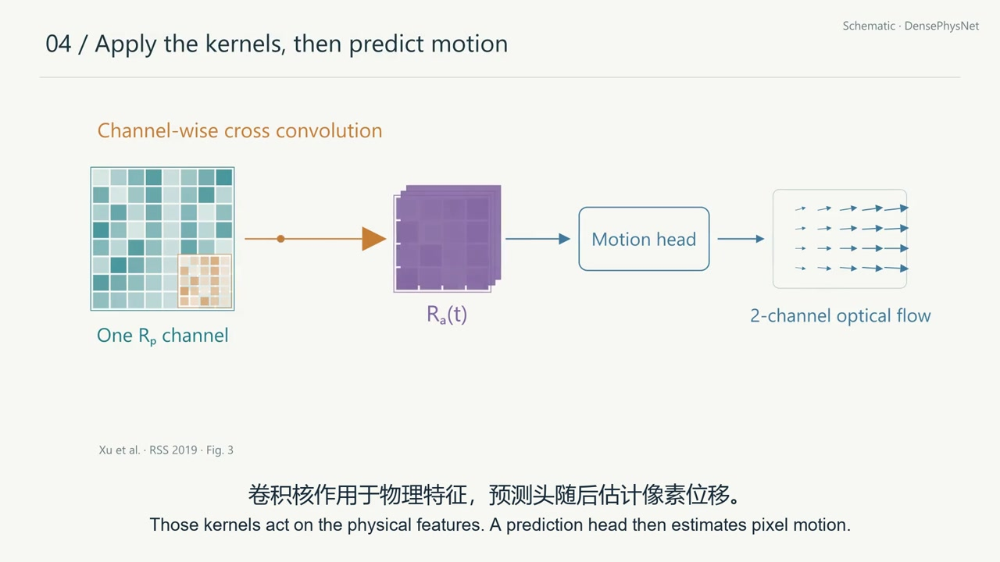
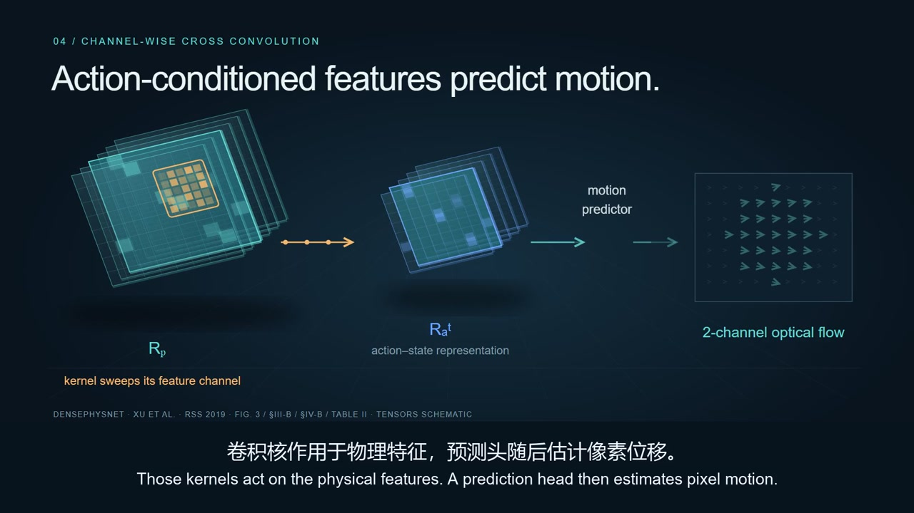
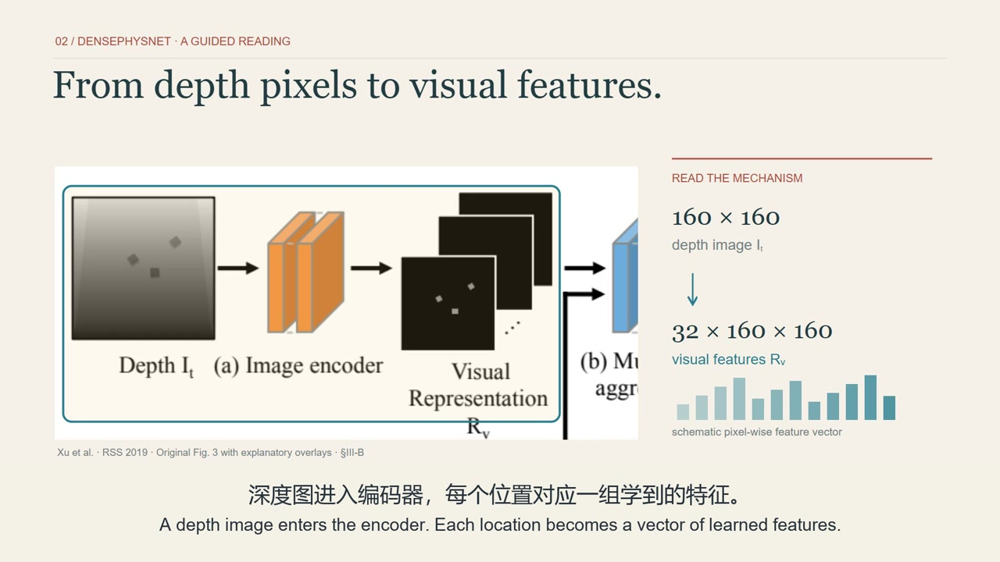

# Paper Explainer Skills

把学术论文做成能看懂技术细节的视频和 HTML 阅读资料。讲解沿着输入、表示变化和输出展开，把关键创新单独讲透，再用原图、基线与实验判断设计的价值。

**[在线查看最新预览与历史样片](https://lizihan25.github.io/Paper-Explainer-Skills/examples/)** · [下载后离线观看](examples/index.html)

这套 prompt 来自论文动画与阅读页的实际制作反馈：动画展开信息流、点流和迭代时，持续保留原论文总览图，用平滑红框说明当前讲到哪里；需要读图时让原图或局部大图占据主画面。作者、年份和研究组帮助记忆，声音与字幕保持连续。内容要求与个人的配色、语速、BGM 等偏好分别说明，方便继续调整。

## 直接使用

选择一种用途与详细程度，把相应 prompt 连同论文或研究问题、受众、范围和交付目标交给模型即可。下列 prompt 均可独立复制。

| 用途 | 精炼版 | 指导版 |
| --- | --- | --- |
| 论文视频 | [目标与制作要求](skills/paper-video/prompts/concise.md) | [研究、分镜、声音与成片衔接](skills/paper-video/prompts/guided.md) |
| HTML 阅读资料 | [内容与阅读效果](skills/paper-reading-html/prompts/concise.md) | [资料组织、交互、资源与页面检查](skills/paper-reading-html/prompts/guided.md) |
| 配音与双语字幕 | [配音交付要求](skills/local-narration/prompts/concise.md) | [可配置环境与完整调用](skills/local-narration/prompts/gpt.md) |
| 文献综述与 HTML | [检索、归纳与教程目标](skills/literature-review-html/prompts/concise.md) | [从检索到综合与阅读页的指导](skills/literature-review-html/prompts/guided.md) |

精炼版适合能自主规划长任务的模型；指导版补充阶段间需要衔接的内容，仍保留选题、叙事和视觉设计空间。本机使用时，把所需的整个 skill 目录复制到支持 `SKILL.md` 的工具的技能目录；Codex 常用位置是 `~/.codex/skills/`。视频和 HTML 可配合 `paper-assets`，配音可配合 `local-narration`。仅能读文件的 GPT 可准备讲稿与执行任务，实际本机渲染和配音由有本地执行权限的工具完成。

例如：

> 使用 $paper-video，介绍这篇论文最有意思的技术设计。沿一个输入解释模型内的信息变化，按默认 A 风格先做一段预览；用常驻原总览图与平滑红框定位。英文固定声线，1.1 倍速度，中上英下字幕。

当前个人优先顺序是 **机制动画＋持续原图定位（新版 A）→ 论文证据导览（早期 C，次优选）→ 纸面自由画布（新版 C）→ 原图显微镜（新版 B）**。实验段优先考虑论文证据导览，可与 A 的机制讲解组合；人类指定风格时采用指定要求，无须每次制作全部风格。

记不清外观时，打开[可视化风格索引](https://lizihan25.github.io/Paper-Explainer-Skills/examples/#style-index)，按封面、用途和实际视频选择。[本地入口](examples/index.html#style-index)使用相对路径，可离线看全部既有样片。早期 DensePhysNet C 结合原架构图与实验表突出证据；DPI-Net C 是自由画布，两者保留完整名称。

## 本机配音与字幕

[local-narration](skills/local-narration/SKILL.md) 复用已有 Breeze-TTS-2 / IndexTTS-2 环境，默认固定合成 F 参考、英文旁白与 1.1 倍处理，并交付双语、英文、中文 SRT 及中上英下 ASS。字幕按实际变速后音轨对齐；改变语速或剪辑后重建时间轴。

首次按 [环境说明](skills/local-narration/references/local-environment.md) 配置 Python、FFmpeg、两个引擎的代码与模型、ASR 缓存路径。公开包提供示例配置，真实机器路径写入被 Git 忽略的本地配置；`--config` 可选择另一份配置。仓库不分发模型权重，也不把个人机器路径写入公共 prompt。固定 F 是合成参考，音频许可见 [第三方说明](THIRD_PARTY.md)。

## 文献综述与阅读资料

[literature-review-html](skills/literature-review-html/SKILL.md) 从研究问题出发检索与筛选文献。尤其入门时，并行优先找优秀综述、专家的文献分享与高质量大学公开课程，沿讲义和阅读清单建立概念与候选文献；同时沿一手来源、关键词与引文关系补齐路线，比较机制、实验条件、证据与缺口。关键结论回原论文核对，多个入口互相补漏。Markdown 保存研究内容，HTML 提供快读、深入阅读、原图导读与人物记忆。研究发展图、教学先修路线和项目候选路线分别表达；篇数、时长和模型分工随任务决定。

作者在对应版本明列的 Keywords 与 Index Terms 分别保留；研究者扩展的领域检索词另列，并整理中英别名、缩写、概念关系与有来源的定义。关键词和定义可搜索、可就近查看，并与论文、方法、数据集及资源双向跳转。近期尚无论文的成熟官方项目与 GitHub 材料可补充时效缺口，记录查询日期、release／commit、公开范围和证据类型；热度用于发现候选。

检索还覆盖各主题的重要数据集、测试集、评测基准与官方榜单，按主题设专栏，解释任务、数据样例、划分、指标与局限。论文与专栏按实际使用关系互相跳转；选文未使用的重要资源列为领域补充，动态榜单标明设置与查询日期。

> 使用 $literature-review-html，围绕这个研究问题检索和归纳文献，解释各条技术路线解决了什么、证据如何、还缺什么，交付中文 Markdown 和可离线阅读的 HTML。

涉及模型的论文同时整理规模、计算与复现条件：底座和可训练参数、训练和推理资源分别说明，代码、权重、数据与训练评测环境逐项核查并链接官方入口。未披露的信息保留具体缺项，实际发布范围与论文承诺分别记录。

HTML原图采用“简短提示＋可展开完整Workflow”：逐步对应图中标签与箭头，解释输入、表示变化、分支汇合、输出用途和训练／使用差别，并可随时放大对照原图。

## 动画工具如何选择

数学推演、动态图形和三维仿真各有适合的工具。参见 [动画技术路线](docs/animation-routes.md)，其中比较 Manim、Motion Canvas、Remotion、After Effects、Blender、Three.js 与 Houdini，以及它们在论文讲解中的用途。

## 素材查找与选择

[paper-assets](skills/paper-assets/SKILL.md) 是视频和 HTML 共用的素材研究 skill，也可以单独使用。它从每个知识点需要呈现的内容出发，寻找论文原图、补充材料、作者演示、实验录像、真实人物照片与声音素材，再比较候选的解释价值、准确性、可读性和画面适配。

例如，解释模型内部的信息传递，可以用原始架构图定位，再用机制动画展示变化；讨论实验效果，则选择条件对应的作者实验片段。选定后记录出处、选择理由、具体截取位置和呈现方式。BGM 与实际旁白一起试听。四份 prompt 都包含独立可执行的素材要求；安装完整技能时，将 `skills/paper-assets/` 一并复制到技能目录。

## 最新预览：A v3 持续原图定位

新版为 **53.50 秒、1080p60、1.1× 固定 F 英文配音**，中上英下字幕及原创轻 BGM。主画面解释机制，右上角原总览图持续保留，红框平滑移动到正在讲解的模块。需要读细节时在主区展示原图局部。

[在线播放](https://lizihan25.github.io/Paper-Explainer-Skills/examples/) · [复制最新 prompts](https://lizihan25.github.io/Paper-Explainer-Skills/examples/prompts.html) · [新版源码与运行说明](source/dpi_styles_v3/REPRODUCE.md)

## 新样片：DPI-Net 信息流

当前制作默认速度已按 2026-10-25 的观看反馈改为原始配音的 **1.1 倍**。本页既有样片仍保留制作时的速度，便于回看比较。

三版以同一段 **47.21 秒、720p24** 的方法讲解比较画面。从粒子状态、动态图、多轮传播和层级，一直讲到预测、动作优化，以及执行后重新观测。旁白使用固定的合成 F 参考声线、整段生成及保留音高的 1.25× 加速；统一加入原创背景音乐 *Particle Study 01*，人声出现时压低音乐。

| Nocturne · 黑底数学剧场 | Microscope · 原图显微镜 | Atlas · 纸面自由画布 |
| --- | --- | --- |
|  |  |  |
| 黑底、语义色族和运动消息，展开图内计算。 | 原图占主要画面，平滑定位与放大对应部位。 | 暖色连续画布，沿空间关系移动观看位置。 |
| [播放 Nocturne](examples/current/dpi-nocturne.mp4) | [播放 Microscope](examples/current/dpi-microscope.mp4) | [播放 Atlas](examples/current/dpi-atlas.mp4) |

[六片本地画廊](examples/index.html) · [双语字幕](source/dpi_styles/subtitles/bilingual.srt) · [英文字幕](source/dpi_styles/subtitles/en.srt) · [中文字幕](source/dpi_styles/subtitles/zh.srt) · [独立渲染源码与运行说明](source/dpi_styles/README.md)

论文：Yunzhu Li、Jiajun Wu、Russ Tedrake、Joshua B. Tenenbaum、Antonio Torralba，[*Learning Particle Dynamics for Manipulating Rigid Bodies, Deformable Objects, and Fluids*](https://arxiv.org/abs/1810.01566)，ICLR 2019，MIT CSAIL。短片聚焦十句方法信息流；完整的实验比较与消融需要更长的讲解。图 1、图 4(c) 和作者头像作为有出处的学术讲解摘引，独立图片不随源码提供。

## 三种早期样片

三片使用同一段 DensePhysNet 讲稿与合成英文音轨，均为 **72.35 秒、1080p60、中上英下字幕**。它们保留当时的语速和无 BGM 版本，展示不同视觉语言。当前 prompt 已加入语速、声线连续性和轻 BGM 的新要求。

[打开本地视频画廊](examples/index.html) · [示例清单](examples/manifest.json)

| A · 科研图解 | B · 张量工作室 | C · 论文证据导览 |
| --- | --- | --- |
|  |  |  |
| Manim 矢量对象，逐步解释特征、卷积与递归状态。 | Remotion 斜投影特征平面，突出通道与动作卷积。 | 围绕原 Fig. 3 定位机制，再看 Table II 的实验结果。 |
| [播放 A](examples/previous/a-paper-schematic.mp4) | [播放 B](examples/previous/b-tensor-studio.mp4) | [播放 C](examples/previous/c-research-editorial.mp4) |

论文：Zhenjia Xu、Jiajun Wu、Andy Zeng、Joshua B. Tenenbaum、Shuran Song，[*DensePhysNet: Learning Dense Physical Object Representations via Multi-step Dynamic Interactions*](https://arxiv.org/abs/1906.03853)，RSS 2019。A、B 的特征与运动场为讲解示意；C 包含署名的原图、原表摘引。

## 许可与素材

原创 prompts、文档和代码采用 [MIT License](LICENSE)。视频、封面以及其中的论文图表、人物照片、音乐和模型生成音频分别适用其来源条件，详见 [第三方素材与音频说明](THIRD_PARTY.md)。

六段样片的旁白由 **Breeze TTS 2** 本地生成，用于研究和非商业展示。该模型的本地输出适用研究与非商业许可；代码的 Apache-2.0 许可不覆盖这些输出。[Breeze TTS 2 官方许可](https://huggingface.co/BreezeBlue/Breeze-TTS-2/blob/main/LICENSE)
